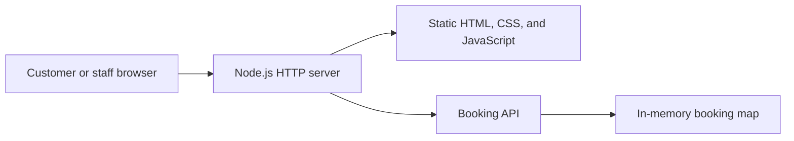

# Juniper Studio · Salon Booking Capstone
CI/CD webhook automation testing.
Juniper Studio is a salon booking demo for one fictional Bengaluru salon and one stylist. It uses Node.js, HTML, CSS, and browser JavaScript with zero npm dependencies. The capstone covers automated testing, Docker packaging, GitHub Actions CI, and a manually triggered deployment to AWS EC2.

## What the app does

| Step | Customer flow |
| --- | --- |
| 1. Appointment | Pick a service, date, and available start time. Buttons show 15-minute increments in 12-hour IST. Past and unavailable times are hidden. |
| 2. Your details | Enter a name, gender option, and 10-digit mobile number. Email and up to 500 characters of notes are optional. |
| 3. Preview | Review the appointment and contact details. Go back to edit or confirm to book. |

After confirmation, the app displays a thank-you screen and returns to the booking home after 10 seconds. Staff use a separate, key-protected schedule to view and cancel appointments for a selected date. Cancellation reopens any affected start times that are still in the future.

The studio is open **10:00 AM–6:00 PM IST**. Each visit lasts **30 minutes**, so 5:30 PM is the last start time. A 10:00 AM booking also blocks 10:15 AM, while 10:30 AM remains available if it has no conflict.

| Service | Price |
| --- | ---: |
| Signature haircut | ₹499 |
| Wash & blow-dry | ₹399 |
| Beard trim | ₹249 |

Prices are displayed for the demo. The app does not collect payments or send messages.

## Run locally

**Requirements:** Node.js 22 or newer and npm. Docker and AWS are optional for local development.

```sh
git clone https://github.com/vijayragaw/salon-booking-capstone.git
cd salon-booking-capstone
npm ci
npm start
```

Open the [booking page](http://localhost:3000/) or the [staff schedule](http://localhost:3000/?view=staff). The local staff key is `local-demo-key`. For a first demo, select tomorrow's date and use fictional names and contact details.

If port 3000 is already in use, run `$env:PORT = '3001'; npm start` in PowerShell or `PORT=3001 npm start` in Bash. Open the same pages on port 3001.

| Command | Purpose |
| --- | --- |
| `npm start` | Serve the frontend and API at `127.0.0.1:3000` by default. |
| `npm run dev` | Restart the server when its imported Node.js files change. Refresh the browser after frontend edits. |
| `npm run check` | Check JavaScript syntax. |
| `npm test` | Run the booking API tests with Node's built-in test runner. |

## Architecture



| Path | Purpose |
| --- | --- |
| [`public/index.html`](public/index.html) | Customer form, thank-you screen, and staff schedule. |
| [`public/booking.js`](public/booking.js) | Navigation, slot rendering, preview, and API calls. |
| [`public/styles.css`](public/styles.css) | Layout, responsive styles, and color palette. |
| [`backend/local.mjs`](backend/local.mjs) | HTTP entry point that serves the pages and API. |
| [`backend/booking.mjs`](backend/booking.mjs) | Services, input validation, availability, and in-memory storage. |
| [`backend/booking.test.mjs`](backend/booking.test.mjs) | Tests for overlapping bookings, validation, staff access, and cancellation. |
| [`Dockerfile`](Dockerfile) | Runs the Node app as the non-root `node` user. |
| [CI workflow](.github/workflows/ci.yml) and [deploy workflow](.github/workflows/deploy.yml) | GitHub Actions verification and AWS deployment. |

**Storage:** Run a single app instance. Bookings live in that process's memory and reset when the process or container restarts, including after redeployment. The server checks for overlap and saves the booking in one synchronous operation, so simultaneous requests cannot reserve conflicting times on that instance.

## API reference

Dates use `YYYY-MM-DD`. API times use 24-hour `HH:mm` in IST. The browser formats them as AM/PM.

| Method | Endpoint | Access | Result |
| --- | --- | --- | --- |
| GET | `/api/services` | Public | Service IDs, names, and prices. |
| GET | `/api/slots?date=YYYY-MM-DD` | Public | Start times and availability flags without customer details. |
| POST | `/api/bookings` | Public | Creates a booking and returns its ID, date, and start time with HTTP `201`. |
| GET | `/api/bookings?date=YYYY-MM-DD` | Staff key | Bookings and customer details for a selected date. |
| DELETE | `/api/bookings/:id` | Staff key | Cancels a booking. Send its `date` and `start` in the JSON body. |

Send the staff key in the `X-Staff-Key` header for staff requests. The API returns `400` for invalid input, `401` for a missing or incorrect staff key, and `409` if a requested time has passed or conflicts with another appointment.

Example JSON body for `POST /api/bookings`. Replace the example date and time with a future available slot.

```json
{
  "date": "2030-06-15",
  "start": "10:15",
  "serviceId": "haircut",
  "name": "Demo Customer",
  "gender": "Prefer not to say",
  "phone": "9000000000",
  "email": "customer@example.com",
  "notes": "Please keep the length."
}
```

## Run with Docker

```sh
docker build -t salon-booking .
docker run --rm --name salon-booking -p 127.0.0.1:3000:3000 salon-booking
```

In another terminal, check the API with `curl http://localhost:3000/api/services`. If the local Node server is already using port 3000, publish the container with `-p 127.0.0.1:3001:3000` and test port 3001 instead.

## GitHub Actions

**CI** runs on pull requests and pushes to `main`. It installs from the lockfile, checks JavaScript syntax, runs tests, builds the Docker image, and starts a container to check `/api/services`.

**Deploy demo to AWS** is manually triggered from `main`. It repeats the application checks, assumes a GitHub OIDC role, uploads a commit-specific source archive to S3, and tells an EC2 instance to build and start the container through Systems Manager. The workflow checks the deployed API and reports the command result.

## Deploy privately to AWS EC2

1. Create a private S3 artifact bucket and launch one Amazon Linux 2023 EC2 instance with outbound internet access. Keep inbound ports closed. Configure the instance as a [Systems Manager managed node](https://docs.aws.amazon.com/systems-manager/latest/userguide/setup-instance-permissions.html). Its role also needs `s3:GetObject` for the bucket's `salon/*` prefix. Confirm that the AWS CLI and SSM Agent are available on the instance.
2. In a Systems Manager shell, install Docker with `sudo dnf install -y docker` and start it with `sudo systemctl enable --now docker`. Create `/etc/salon-booking.env` with permissions `600` and set `STAFF_KEY` to a long random secret. Keep that file on the instance.
3. Configure a GitHub environment named `aws` restricted to `main`. Create a [GitHub OIDC deployment role](https://docs.github.com/en/actions/how-tos/secure-your-work/security-harden-deployments/oidc-in-aws) scoped to this repository's `aws` environment. Grant it access to upload to the artifact prefix, send `AWS-RunShellScript` commands to the selected instance, and read command status.
4. Set these environment variables in GitHub and run **Actions → Deploy demo to AWS → Run workflow** on `main`.

| GitHub environment variable | Value |
| --- | --- |
| `AWS_REGION` | Region containing the EC2 instance. |
| `AWS_DEPLOY_ROLE_ARN` | ARN of the IAM role assumed by GitHub Actions. |
| `ARTIFACT_BUCKET` | Private S3 bucket name, without `s3://`. |
| `INSTANCE_ID` | EC2 instance ID, starting with `i-`. |

With the AWS CLI and the [Session Manager plugin](https://docs.aws.amazon.com/systems-manager/latest/userguide/session-manager-working-with-sessions-start.html#sessions-start-port-forwarding) installed locally, open a port-forwarding session using an AWS identity allowed to start it.

```sh
aws ssm start-session --target i-REPLACE --document-name AWS-StartPortForwardingSession --parameters "portNumber=3000,localPortNumber=3000"
```

Keep the session open and visit [localhost:3000](http://localhost:3000/). Set `localPortNumber=3001` if port 3000 is already occupied on your machine. The container is published on the EC2 instance's loopback address.

EC2, EBS, and S3 usage can consume AWS credits. Review your account's billing dashboard before starting, and clean up the instance, unused volumes, and deployment artifacts when finished. The shared staff key and in-memory storage are intended for a private capstone demo.

## Demo checklist

1. Create a pull request with a deliberately failing test, show CI catching it, then fix the test and show the pipeline passing.
2. Run the Docker container or deploy it to EC2 and open it through the SSM tunnel.
3. Select the same appointment in two tabs. Confirm the first booking and submit the stale preview from the second tab to demonstrate conflict handling.
4. Review the thank-you screen and its automatic return to the booking home.
5. Open `/?view=staff`, cancel the appointment, and verify that the start time reappears for customers.
